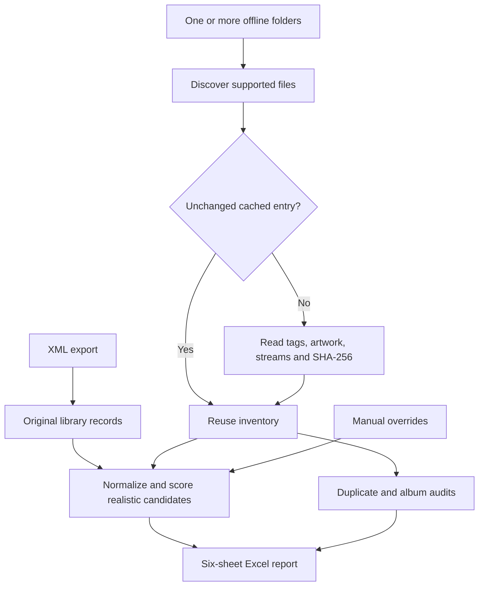

# Music Library Audit

A local, read-only Python application that compares an Apple Music/iTunes library XML export with any number of offline music folders and writes an Excel audit. Designed for **Windows, macOS, and Linux**, with Python 3.10 or newer.

It answers: Which library tracks have a usable offline copy? Which need review? What is missing? Which files have artwork, metadata, integrity, duplicate, or album-completeness issues?

The application does not sign in to Apple, access an account, upload a library, remove DRM, or change music files. An XML export is its input; streaming-library access is not required. Linux can audit an XML exported on another computer.

## Start here

Install **Python 3.10+**, **FFmpeg**, and **FFprobe**. Both media executables must be on PATH. Use the [official FFmpeg download page](https://www.ffmpeg.org/download.html) for platform packages. On macOS with Homebrew, `brew install ffmpeg` installs the tools; on Debian/Ubuntu, use `sudo apt install ffmpeg`. Windows users can install a Windows build and add its executable directory to PATH. Open a new terminal after installing.

Verify:

```text
ffmpeg -version
ffprobe -version
```

Choose **one** Python dependency workflow below. Neither workflow bundles FFmpeg.

### Option A: uv

Install [uv using its official instructions](https://docs.astral.sh/uv/getting-started/installation/). From the downloaded project directory, the same commands work in PowerShell, bash, and zsh:

```text
uv sync --locked
uv run --locked python src/audit.py --setup
uv run --locked python src/audit.py --inspect
uv run --locked python src/audit.py
```

`--setup` asks for the XML and then asks for music folders one at a time. Enter `done` or `that's all` when finished. It saves the choices and exits without scanning. The last command runs the audit. On a first interactive run without configured music folders, the application opens the setup flow automatically, then continues the audit.

On an interactive run, matching then asks whether you want to review the remaining REVIEW entries. If you answer yes, each Apple Music track is shown with its best candidate and reason. Answer yes to confirm it; the choice is saved immediately as a manual override and becomes MATCHED. Answer no to reject that candidate and try the next retained candidate. Answer quit to stop while preserving earlier decisions. If all candidates are rejected, the entry remains REVIEW for safety. Use `--review` to start this pass directly, or `--no-review` to suppress the offer. Non-interactive runs never prompt.

### Option B: standard Python and pip

Windows PowerShell:

```powershell
python -m venv .venv
.\.venv\Scripts\python.exe -m pip install -r requirements.txt
.\.venv\Scripts\python.exe src/audit.py --setup
.\.venv\Scripts\python.exe src/audit.py --inspect
.\.venv\Scripts\python.exe src/audit.py
```

If `python` is unavailable but the Windows launcher is installed, use `py -3 -m venv .venv` for the first command.

macOS or Linux:

```bash
python3 -m venv .venv
.venv/bin/python -m pip install -r requirements.txt
.venv/bin/python src/audit.py --setup
.venv/bin/python src/audit.py --inspect
.venv/bin/python src/audit.py
```

After activating the virtual environment, `python src/audit.py` also works. Direct executable paths above avoid activation and PowerShell execution-policy issues. On Linux, install the distribution's Python venv package if `python3 -m venv` is unavailable.

## Compare an Apple Music XML with a purchased-music XML

`src/compare_libraries.py` answers a smaller question than the audit: which tracks in your Apple Music library are not in a second (for example purchased/offline) library? It needs Python and openpyxl (installed by the dependency steps above), not FFmpeg, and reads two XML exports without touching any audio.

```text
python src/compare_libraries.py
python src/compare_libraries.py --apple "input/Library.xml" --purchased "input/Purchased.xml"
```

Without options it lists XML files found nearby and asks you to pick the Apple Music XML and then the purchased XML by number or path. The default workbook is `output/Apple_Music_Not_In_Purchased.xlsx` in the workspace (override with `--output`, a `.xlsx` path inside the workspace). Columns: Title, Artist, Album, Year, Duration, iTunes Link, Status, Closest Purchased Track, Reason.

A track is compared by Persistent ID, then by normalized title, credited artists, version markers (remix, live, remaster...) and duration within the configured tolerance. Track IDs are never used: they are per-library numbers and collide between unrelated libraries. Rows are `NOT IN PURCHASED` or `POSSIBLE MATCH` (title and artist look alike but version, artist credits, duration or video status differ; check by hand). `--include-matched` also lists confident matches as `MATCHED`. The `iTunes Link` column is filled only if the XML contains a store URL field; standard exports do not, so it is usually empty.

## Find downloaded music that duplicates purchases

`src/reconcile_libraries.py` adds a third source: a folder of music you collected elsewhere. It needs the normal dependencies and FFprobe (see Start here) because it reads the folder's tags and durations with the audit scanner, but it skips SHA-256, so each file is not read in full. Results are cached in `cache/reconcile`.

```text
python src/reconcile_libraries.py --apple "input/Library.xml" --purchased "input/Purchased.xml" --music-root "/path/to/downloads"
```

Optional: `--duration-seconds N` (0-30, default 10) sets the largest duration difference still treated as the same song.

Omitted options are asked for interactively (`--music-root` can repeat; saved audit folders are used if present). It writes three Excel workbooks to `output/`:

| File | Contents |
|---|---|
| `Internet_Duplicates_Of_Purchased.xlsx` | One row per downloaded file that matches a purchased track, with a recommendation, both tracks' details and formats |
| `Purchased_Albums_In_Internet_Collection.xlsx` | Per purchased album: tracks, how many have a downloaded copy, how many purchased files exist on disk, files to remove |
| `Apple_Music_Missing_Everywhere.xlsx` | Apple Music tracks found in neither the purchased XML nor the folder (`MISSING EVERYWHERE`), or only weakly (`POSSIBLE MATCH`) |

Downloaded files are matched by **title, artist and duration, ignoring the album**, because the same song legitimately sits on a single, an "all time hits" compilation and the original album. Each match gets a tier:

| Match Type | Meaning |
|---|---|
| Strict | Passes the audit matcher's automatic gates (near-identical title, artist and duration, readable DRM-free audio) |
| Likely | Same song title and artist, duration within `--duration-seconds` (default 10), same kind of recording. Tolerates `(Remastered)`, `(Explicit)`, `- Single Version`, feature credits, `The Beatles` vs `Beatles`, `Artist & Guest` vs `Artist`, a track number in the title, and untagged files whose artist and title come from the filename (`03 - Artist - Song.mp3`) or folder name |
| Possible | Similar, but a person should look: a live/remix/acoustic version, a large duration gap, a weak artist match, or an unreadable/protected file |

Live, remix, acoustic, demo, instrumental, karaoke and extended versions never count as the same recording as a plain one, and "Part 1" never matches "Part 2".

The tier and the purchased file's state decide the recommendation. **REMOVE CANDIDATE** needs a Strict match; a Likely match is **LIKELY DUPLICATE: review, then remove**; both also need the purchased track's `Location` in the XML to be an existing file whose size still equals the XML size. Purchased tracks without a `Location` (cloud-only, `Track Type` Remote) are `KEEP: purchased copy not downloaded`: download them in iTunes first, then export a new XML and rerun. A purchased file listed in the XML is itself never offered as a candidate. Other labels: `KEEP: purchased file not found on this computer`, `REVIEW: purchased file differs from the XML`, `REVIEW: possible match, not confident`. The `Album Tracks In This Folder` column (for example `9 of 12`) shows how many tracks of that purchased album sit in the same downloaded folder; a high count makes a Likely match much more convincing. `Apple_Music_Missing_Everywhere.xlsx` counts Strict and Likely matches in either source as present, so only tracks with no plausible copy are `MISSING EVERYWHERE`.

**The program never deletes, moves or edits anything.** Open the workbooks in Excel, review the plan (sort by `Recommendation`, compare the format and bitrate columns, since a downloaded FLAC or 320 kbps file may sound better than a 256 kbps purchase) and remove files yourself. Run it on the computer that holds both the downloaded folder and the purchased files, otherwise every purchased file looks missing.

## Run again with an updated XML

1. Export the updated library from your music application.
2. Replace the XML at the path you configured. With the default location, that is `input/Library.xml`; create `input` if necessary.
3. Connect the saved offline drives and close the previous workbook in Excel.
4. Run `uv run --locked python src/audit.py`, or use the Python executable from Option B.

The program **reads the XML again on every run**. It reuses offline metadata, hashes, and probe results when file path, size, and modification timestamp are unchanged. New or changed files are scanned. Removed files disappear from the current report. Cache entries for older paths may remain in SQLite but are not included unless rediscovered.

The report is replaced each run. Copy it elsewhere yourself first if you want historical reports. If a viewer such as Excel locks the configured workbook on Windows, the scan still completes and writes `*_new.xlsx`; close the old workbook and rerun when you want the configured filename updated. Do not delete the cache just because the XML changed.

To choose a different XML for one run:

```text
uv run --locked python src/audit.py --xml "input/UpdatedLibrary.xml"
```

To save new XML/folder selections, run `--setup` again, or use `--save-config` with the command-line options. If you move to another OS, run setup again: drive letters and mount paths differ, and old path-based cache entries do not automatically transfer.

## Select multiple folders or automate a run

An interactive setup looks like this; names are illustrative:

```text
Library XML [...]: input/Library.xml
Music folder 1, or done (That's all): /path/to/first-collection
Music folder 2, or done (That's all): /path/to/second-collection
Music folder 3, or done (That's all): done
```

Use real local paths appropriate for your OS. Spaces and Unicode are supported. In the setup prompts, type or paste one path per answer; surrounding quotes are accepted. At least one folder is required. Duplicate folder entries are rejected. Reconfiguring replaces the entire saved folder list.

For scripts, repeat `--music-root` once per folder:

```text
uv run --locked python src/audit.py --xml "input/Library.xml" --music-root "music-one" --music-root "music-two" --save-config --non-interactive
```

Relative paths are resolved against the **workspace**, which defaults to the project directory, not against an arbitrary current terminal directory. Absolute paths and `~` home expansion are accepted. No environment-variable or wildcard expansion is performed by the app itself.

| Option | Purpose |
|---|---|
| `--setup` | Ask for XML and folders; save settings and exit |
| `--xml PATH` | Override the XML for this run |
| `--music-root PATH` | Repeat for multiple roots; replaces the saved list |
| `--save-config` | Persist explicit command-line input choices |
| `--inspect`, `--dry-run` | Validate paths, tools, XML and file discovery without reading every audio file |
| `--inventory-only` | Scan/cache files and write the preliminary two-sheet workbook |
| `--workspace PATH` | Store private settings, cache and output in this workspace |
| `--config PATH` | Use another settings file; its parent is the default workspace if `--workspace` is absent |
| `--non-interactive` | Fail with an explanation instead of prompting for unconfigured inputs |
| `--review` | Start one-by-one interactive review after matching |
| `--no-review` | Suppress the interactive review offer |

Example of keeping private runtime data outside a source checkout: supply `--workspace "../audit-data"` to setup and to each later audit/validation command. The application prevents its write destinations from overlapping read-only music folders. All runtime writes stay inside the selected workspace. `--inspect` may create output/cache directories and a log; it is not a promise of zero application-file writes.

## What happens during an audit?

1. **Read settings and validate inputs.** Confirm the XML, music roots, output permissions and media tools.
2. **Read the XML.** Preserve original properties and report field coverage, even if optional metadata is absent.
3. **Discover files.** Combine the selected folders while retaining the root for each path. Directory symlinks/junctions and file symlinks are skipped.
4. **Inventory audio.** Reuse cache hits; otherwise read tags/artwork with Mutagen, inspect streams with FFprobe, and calculate a SHA-256 digest by reading the file. Identify AppleDouble metadata sidecars separately.
5. **Prepare comparisons.** Normalize harmless text differences and featured-artist credits without discarding recording-version evidence.
6. **Match candidates.** Use title, artist and duration indexes to shortlist plausible files. Score candidates conservatively; apply explicit manual overrides if present.
7. **Audit quality.** Report metadata/artwork/integrity issues, four duplicate categories, and album/disc completeness according to available tags.
8. **Write Excel.** Produce a dashboard and detailed filterable sheets with explanations and local file links.



See [IMPLEMENTATION.md](IMPLEMENTATION.md) for the exact algorithm, data flow, and every source module.

## Understand the workbook

Default output: `output/Music_Library_Audit.xlsx`. The source inventory is also written to `output/Preliminary_Inventory.xlsx`.

| Sheet | Contents |
|---|---|
| Dashboard | Track/file totals, match counts and percentages, quality issues, duplicate and album findings |
| Apple Music Library | Original XML fields plus separate normalized comparison fields |
| Offline Library | All discovered supported-extension files, paths, tags, streams, artwork, hashes, eligibility and errors |
| Match Results | Status, scores, reasons, chosen candidate, up to three alternatives, other relevant copies and quality warnings |
| Album Audit | Expected/actual/missing/repeated track numbers, disc gaps and inconsistent totals |
| Duplicates | Exact binary duplicates and three metadata-based duplicate/recording categories |

**MATCHED** is green, **REVIEW** orange, **MISSING** red. Matched rows with metadata/artwork warnings are yellow. A high score is a heuristic score, not a statistical probability. An automatic MATCHED result additionally requires strong title and artist agreement, duration within tolerance, compatible version evidence, a real title tag and an archive-eligible file. Video items require review for an automatic audio-only match.

REVIEW retains meaningful candidates, including some below the configured review threshold. Its three candidate columns include its leading suggestion. Missing album tags or artwork do not by themselves turn a valid recording match into MISSING. Protected or unreadable files may be review evidence but cannot satisfy archive coverage.

An album marked **COMPLETE ACCORDING TO TAGS** has the track numbers its own tags suggest. This is not a comparison with an authoritative discography. Identical album/artist tags can merge multiple editions. Repeated numbers can also represent copies on different roots.

Supported extensions: `.mp3`, `.m4a`, `.m4p`, `.flac`, `.aac`, `.wav`, `.ogg`, `.opus`, `.wma`. An extension is only a discovery hint. AppleDouble `._` sidecars are recognized by their binary header, kept in the inventory, and excluded from audio, duplicate, album and artwork totals.

## SHA-256: why a cryptographic hash?

SHA-256 produces a fixed-size digest of a file's bytes. Here it is used to identify **exact binary duplicates** efficiently: the same bytes produce the same digest, regardless of filename or folder. Accidental collisions are extraordinarily unlikely, so this is strong practical duplicate evidence; the program does not perform a second byte-for-byte comparison.

This is **hashing, not encryption**. It requires no password, account, API key, or secret. Python's built-in `hashlib` provides it; the audit does not depend on the separate `cryptography` package. It does not conceal your music or metadata.

Changing tags or artwork changes the bytes and therefore the hash, even if the song sounds identical. Different encodings also have different hashes. SHA-256 cannot tell whether two differently encoded files contain the same recording, nor prove a recording is correct or uncorrupted without a trusted reference hash. Metadata matching and FFprobe/FFmpeg checks answer different questions. Acoustic fingerprinting is a possible future addition, not a current requirement.

The first hash pass reads every file fully and can take a long time on external drives. Later runs normally reuse the cached hashes. See [FAQ.md](docs/FAQ.md).

## What is uv, and why use it?

`uv` is a Python package/environment manager from Astral. In this project it provides a convenient way to create `.venv`, install the locked dependencies, and run commands in that environment. It is **optional**: the application runs with Python and pip as shown above. It is not the scanner, matcher, or hashing algorithm.

`pyproject.toml` declares dependency ranges; `uv.lock` records a resolved dependency set. `uv run --locked` checks that the lock agrees with the project and prepares the environment before running Python. Dependency installation may access package servers; the audit application itself does not upload music or use online matching. [uv project documentation](https://docs.astral.sh/uv/guides/projects/), [locking and syncing](https://docs.astral.sh/uv/concepts/projects/sync/).

## Settings, overrides and deep checks

`config.example.json` is a public template with no personal paths. Setup creates private `config.json`, which Git ignores. Missing `manual_matches.json` means no overrides; copy `manual_matches.example.json` to that name if you want to edit it.

Map a Persistent ID copied from the workbook to a local offline path:

```json
{
  "EXAMPLE_PERSISTENT_ID": "music-one/Example Album/01 Signal.flac"
}
```

The key above is a placeholder, not a real ID. A valid manual override is labeled **MANUAL MATCH**, with identity confidence 100; eligibility is still checked. A missing target stays REVIEW and does not silently choose a substitute. Paths may be absolute or relative to the workspace. If no Persistent ID exists, `track:<Track ID>` is a less stable fallback.

Fast mode is the default: **PASS (probe only)** means that metadata/stream inspection passed; `Deep Integrity` remains **NOT TESTED**. Setting `deep_integrity_check` to `true` enables a full FFmpeg decode to a discarded null stream, without generating audio output. It can take much longer. The local SQLite cache is keyed by path, size, nanosecond modification timestamp and scanner version. Enabling deep mode rechecks entries without a completed deep result; existing deep results may be reused even after switching fast mode back on.

See the [configuration reference](docs/CONFIGURATION.md) and [privacy/publication guide](docs/PUBLISHING.md).

## Development and publication

```text
uv run --locked python -m unittest discover -s tests -v
uv run --locked python src/validate_report.py
python scripts/prepare_release.py
```

The validator requires an existing report and its local XML/cache. Tests instead create temporary synthetic data and never need a real library or saved personal settings.

The release script copies only explicitly approved public files into a new `dist/music-library-audit` directory and ZIP, or a numbered sibling if it already exists. It does not include local settings, XML, reports, cache, audio, the original specification, virtual environments, Git history or test bytecode. **Publish that clean directory**, following [PUBLISHING.md](docs/PUBLISHING.md). The script also checks for common credential and personal-path patterns; review the bundle because automated checks cannot prove universal anonymity.

Code can be free of personal information while a GitHub account, remote URL, commit author/email, or public issue still identifies its publisher. Those are separate publication choices. No remote repository is created or pushed by this application.

Platform status: Windows execution has been tested during development. A GitHub Actions matrix is provided for native Windows, macOS and Ubuntu tests on Python 3.10 and 3.14; those remote jobs must pass before claiming all platforms are verified.

Further reading: [Implementation and source map](IMPLEMENTATION.md) · [FAQ](docs/FAQ.md) · [Developer handoff](docs/DEVELOPER_HANDOFF.md) · [Contributing](CONTRIBUTING.md) · [Security and privacy](SECURITY.md) · [Changelog](CHANGELOG.md).
